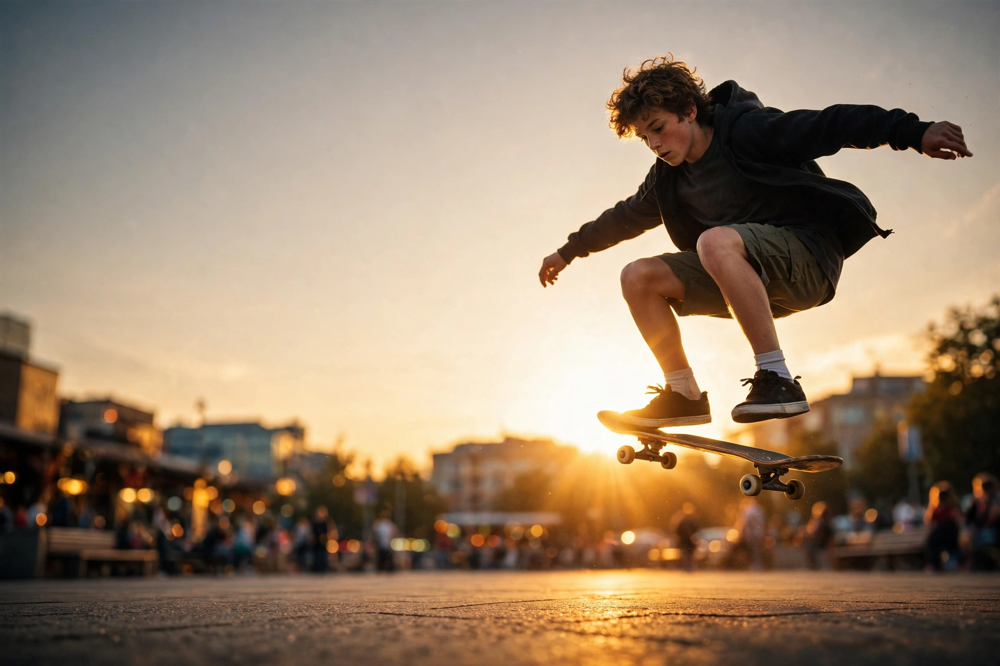

# 第 1 章：一张照片，八个决定

摄影师按下快门只要 0.1 秒。但在这 0.1 秒之前，他的脑子里已经开了 8 个会。

这一章，我们拿一张照片，把这 8 个会一个一个旁听完。听完你会发现：以后你指挥 AI 画图，指挥的也就是这 8 件事——只不过摄影师用手拧，你用嘴说。

看这张图：黄昏的广场，一个少年腾空抓板。拍下它的人，在按快门前同时做了 8 个决定。

## 决定 1：光圈——背景要不要虚化

**是什么**：镜头里的"瞳孔"。数字越小（比如 f/1.8），瞳孔越大，进光越多，背景越虚化；数字越大（比如 f/11），前后都清楚。

**13 岁版**：天黑了你的瞳孔会放大，多进点光好看清路——光圈一个道理。f/1.8 就是"瞪大眼睛"：主角清晰，路人全虚掉，适合拍人；f/11 就是"眯起眼睛"：毕业合影必须用这个，不然最后一排全是糊的。

**这张图**：光圈开大，广场上的人群和楼房全虚化成色块，只有少年是实的。你的眼睛一下就被拽到他身上——这就是光圈在"指挥视线"。

## 决定 2：快门——时间要不要凝固

**是什么**：快门是"眨眼"。1/2000 秒眨一下，腾空的人定在半空；慢到 1 秒再眨，夜晚的车流会被拉成光带。

**13 岁版**：你眨眼越快，看到的瞬间越"定格"。想拍水花、扣篮、猫起跳，就把眨眼调到最快。反过来，拍夜景车流光带、拍瀑布拉丝，就故意眨得慢。

**这张图**：快门 1/2000 秒，滑板停在半空，鞋带都定住了。如果快门慢半拍，这张就是一团糊——少年"飞"的感觉全靠这次眨眼。

## 决定 3：ISO——天黑了怎么办

**是什么**：相机的"夜视能力"。ISO 调高，暗处也看得见，代价是画面起"噪点"——像老电视没信号时的雪花。

**13 岁版**：演唱会内场不让开闪光灯，你手机拍出来全是噪点，就是 ISO 被迫拉太高了。记住顺序：能加光就加光，实在没光才拉 ISO，拉完别放大看。

**这张图**：傍晚光线已经很暗，ISO 拉到 1600 才拍下来。放大看影子部分，有一点点颗粒——这就是代价，摄影师觉得值。

## 决定 4：焦段——站多远，看多"挤"

**是什么**：镜头看世界的"宽窄"。广角（数字小）视野大，长焦（数字大）看得远，还会把空间"压缩"。

**13 岁版**：自拍杆就是广角——腿显得长，宿舍全景一杆搞定。长焦是把远处"拽"到眼前：操场上跑步的人会被挤成一团，月亮会变得巨大。拍球赛、拍月亮、偷拍猫，都用长焦。

**这张图**：中焦，不远不近——人和广场环境都要，少年"在城市里飞"的感觉才完整。

## 决定 5：角度——蹲下还是举高

**是什么**：相机放多高、朝哪歪。三个常用角度，各管各的：

**13 岁版**：
- **低角度仰拍**：人变高、变帅、变有气势。想显腿长，把手机放到脚踝高度往上拍——你朋友圈那些大长腿全是这么来的。
- **高角度俯拍**：脸显小。你举高手机自拍就是这个道理；但全身会被压矮，变"萌"。
- **平视**：最自然，拍朋友聊天、拍猫对视都用这个。

**这张图**：摄影师几乎趴在地上仰拍，少年像飞起来一样。站着拍，顶多是"跳得挺高"；趴着拍，就是"飞"。

## 决定 6：构图——东西放哪

**是什么**：画面里的摆法。记住四个就够：

**13 岁版**：
- **三分法**：一句话——别把人怼在正中间。画面切成九宫格，人放交叉点上，立刻顺眼。
- **引导线**：马路、栏杆、楼梯会把眼睛"带"向主角，像游戏里的指引箭头。
- **框架**：用门框、窗户当相框，主角往里一放，立马有故事感。
- **留白**：少年头顶的天空是"留白"，是他"飞"的空间——顶到天花板就飞不动了。

**这张图**：少年在右侧交叉点上，广场地面线条指向他，头顶留白。8 个决定里，这个最不花钱——手机也能练。

## 决定 7：光线——太阳站在哪

**是什么**：光从哪个方向来，决定照片的"立体感"和"情绪"。

**13 岁版**：
- **顺光**（光在你身后）：照证件照，清楚但很"平"，没立体感。
- **侧光**（光在旁边）：脸一半亮一半暗，最有立体感，男生拍酷照用这个。
- **逆光**（光在对面）：人会变剪影，但发丝会发光——这张图就是逆光，少年的轮廓镶了一圈金边。
- **时间**：正午顶光 = 熊猫眼（眼窝全黑），中午别拍人；日出日落前后一小时叫"黄金时刻"，怎么拍怎么好看，约拍照就约这个点。

**这张图**：逆光 + 黄金时刻。顺光拍，少年就是个普通玩滑板的人；逆光拍，他有了金边，有了"主角光环"。

## 决定 8：色彩——暖还是冷

**是什么**：画面的"温度"。暖色（黄橙红）= 热闹、怀旧、有食欲；冷色（蓝青）= 冷静、孤独、科技感。

**13 岁版**：同一家奶茶店，白天拍是"约会"，深夜调冷色拍是"emo"。想表达什么情绪，先定温度。

**这张图**：整体暖黄，青春 + 热血。如果调成冷蓝，同一个少年，故事就变成"没人看他比赛"了。

## 小结：开完 8 个会，才按快门

光圈、快门、ISO、焦段、角度、构图、光线、色彩。摄影师不是"咔嚓"一下，是开完 8 个会才按快门。好消息是：这 8 个会，你用手机现在就能开——手机的人像模式就是在帮你开"光圈"的会。

## 桥：这 8 个决定，怎么变成跟 AI 说的话

以后你指挥 AI，用的就是同一套词，翻译一下：

- 光圈虚化 → "背景虚化，主体清晰"
- 快门凝固 → "凝固在半空，水花定格"
- 夜景 ISO → "夜景，有轻微噪点，真实感"
- 焦段 → "广角，大长腿" / "长焦，压缩空间"
- 角度 → "低角度仰拍" / "高角度俯视"
- 构图 → "三分法，主体在右侧交叉点，头顶留白"
- 光线 → "逆光，轮廓光，黄金时刻"
- 色彩 → "暖黄怀旧色调" / "冷蓝孤独感"

从第 2 章起，我们拿一个决定单拧，拧到你闭眼会说。

## 专业摄影圈的知识层级（地图，不是考级）

摄影圈聊"水平"，其实聊的是你在第几层。用游戏段位讲：

- **青铜 · 器材层**：相机会开机，知道光圈快门 ISO 三个钮是干嘛的。圈里叫"懂曝光"。这一章读完，你就在这里了。
- **白银 · 技术层**：构图、角度、用光、色彩都练熟，拍什么都清楚好看。大多数人一辈子停在这里，也挺好。
- **黄金 · 题材层**：开始选方向——人像、街头、体育、风光、美食……每个题材有自己的规矩和前辈，进哪个门，拜哪个师。
- **铂金 · 语言层**：有稳定的个人风格，别人一看就知道是你的片子；会组图、会讲故事——一组照片就是一篇文章。
- **钻石 · 观念层**：照片开始"说话"：表达观点、记录时代。办展、出书、拿奖的是这层。
- **王者 · 生态层**：靠摄影吃饭：商业拍摄、教学、器材测评、策展。拼的不是技术，是审美信用和人脉。

一句话：青铜到白银靠练手，黄金靠选方向，铂金以上靠脑子。这本书带你从青铜打到黄金，铂金的门给你指出来，推不推，看你。

## 作业：填空题（明天交一张图）

把下划线填上**你感兴趣的东西**，用手机拍一张（或用 AI 生成一张）交上来：

"拍____（你感兴趣的东西，比如：我的猫、我最爱的球鞋、游戏里的角色），它正在____（干什么），在____（哪里），用____（什么光，比如：傍晚的逆光），从____（什么角度，比如：低角度仰拍），背景____（虚化还是清楚）。"

**示范**：拍"我的橘猫"，它正在"扑一只蝴蝶"，在"阳台上"，用"傍晚的逆光"，从"低角度仰拍"，背景"虚化"。

交：① 图 ② 你填好的完整句子。明天课上先看图，再开新章。
## 后路

下次你看到任何一张好照片，能说出它背后哪 3 个决定做得好——第 1 章就没白学。第 2 章，我们单拧"光圈"。
