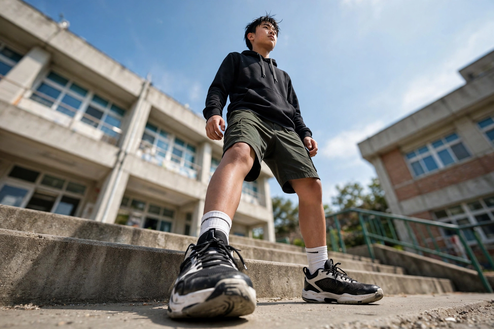

# 第 6 章：角度——蹲下还是举高

同一双腿，为什么她拍出来一米八，你拍出来一米五？差的不是腿，是机位。

看这张图：镜头贴在地面上往上拍，台阶上的少年像巨人一样。这不是他长高了，是角度在"撒谎"——而且是善意的谎。

## 角度是什么

**一句话**：相机放多高、朝哪歪，决定人物"变高还是变矮、变帅还是变萌"。

**13 岁版**：记住四招：

- **低角度仰拍**：人变高、变帅、变有气势。想显腿长，手机放到脚踝高度往上拍——朋友圈的大长腿全是这么来的。但注意：仰拍别拍脸，容易出双下巴，拍全身最保险。
- **高角度俯拍**：脸显小。你举高手机自拍就是这个道理；但全身会被压矮，变"萌"。
- **平视**：最自然、最真诚。拍朋友聊天、和猫对视，都用这个。
- **倾斜（荷兰角）**：故意把画面拍歪一点，动感、叛逆，滑板街头风常用。别歪太多，5–10 度就行。

**两个冷知识**：
1. 拍小孩和宠物，一定要蹲到和他们一样高——大人站着俯拍小孩，全是"头大身小"。
2. 拍球鞋、滑板这类"装备"，贴地仰拍自带广告感。

## 提示词翻译

- 要高大："低角度仰拍，人物高大有气势"
- 要脸小："高角度俯视，脸显小"
- 要动感："倾斜构图，街头动感"

## 可复现实验

同一双球鞋，三种角度各拍一张：贴地仰拍 / 蹲下平视 / 举高俯拍。看哪双"最贵"——你会发现角度是最便宜的滤镜。

## 翻车预警

- **双下巴翻车**：仰拍怼脸，下巴先投降——仰拍拍全身，俯拍拍脸。
- **歪过头翻车**：荷兰角超过 15 度，观众以为你手抖——小歪是风格，大歪是事故。

## 作业：填空题（明天交一张图）

"拍____（人或东西，比如：我朋友、我的球鞋），我想让他____（变高大 / 显脸小 / 有动感），所以用____（低角度仰拍 / 高角度俯视 / 倾斜）。"

**示范**：拍"我的球鞋"，我想让它"有广告感"，所以用"贴地仰拍"。

交：① 图 ② 填好的句子。

## 后路

角度是免费的整容：举高脸小，趴下腿长。第 7 章，我们聊"构图"：东西到底放哪。
