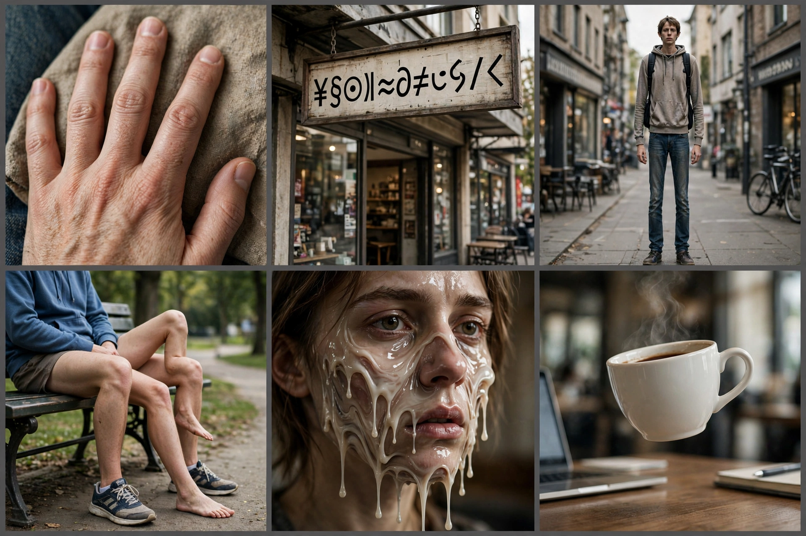

# 第 10 章：翻车现场——12 个问题集中修

前面 9 章是"怎么开车"，这一章是"修车厂"。12 个真实翻车，每个都按"症状 → 病因 → 自查 → 解法 → 预防"五步修。带 [拍照] 的是相机/手机翻车，带 [AI] 的是 AI 生图翻车。

修之前先记住第 1 章的地图：1–6 号是物理翻车（光、镜头、你的哪个环节错了），7–12 号是"没把决定说清楚"翻车（AI 按默认发挥了）。每个病因，都能在地图上找到位置。

## 1. 照片糊了 [拍照]

- **症状**：放大一看，全是糊的。
- **病因**：快门太慢 + 手抖。
- **自查**：看快门速度，低于 1/60 就是它。
- **解法**：快门提到 1/125 以上，或把手机架在桌上/靠墙。
- **预防**：按快门前先看快门速度，再看画面。

## 2. 逆光下人脸全黑 [拍照]

- **症状**：风景很美，人是黑的。
- **病因**：相机测光测到了亮处，脸被放弃了。
- **自查**：点一下屏幕上的人脸，看亮度跳不跳。
- **解法**：点测人脸对焦测光；或找朋友拿手机从前面补一下光；或干脆接受剪影——剪影也挺美。
- **预防**：逆光拍摄前先决定：要脸，还是要剪影。

## 3. 合影最后一排全糊 [拍照]

- **症状**：前排清楚，后排鬼影。
- **病因**：光圈太大，景深不够深。
- **自查**：光圈是不是 f/2 左右。
- **解法**：收到 f/8，人越多数字越大。
- **预防**：人越多，光圈数字越大——刻进 DNA。

## 4. 夜景全是噪点 [拍照]

- **症状**：暗部雪花点开会。
- **病因**：ISO 爆表。
- **自查**：看 ISO，是不是 6400+。
- **解法**：按"找光 > 架稳 > 拉 ISO"的顺序重来一遍（第 4 章）。
- **预防**：天黑先找光源，别先拉 ISO。

## 5. 地平线是歪的 [拍照]

- **症状**：海是斜的，楼是歪的。
- **病因**：没看水平线。
- **自查**：打开手机网格线。
- **解法**：修图里旋转拉直，1 分钟。
- **预防**：按快门前看一眼地平线，3 秒钟的事。

## 6. 背景抢戏 [拍照]

- **症状**：主角挺好，背景里有电线杆"长"在头上。
- **病因**：按快门前没看背景。
- **自查**：主角头顶/身后有没有乱入的东西。
- **解法**：开大光圈虚化它，或挪一步换角度，或走近点。
- **预防**：先看背景，再看主角——顺序反过来。

## 7. 手有六根手指 [AI]

- **症状**：手部特写，手指数量不对。
- **病因**：模型对手的结构学得不好。
- **自查**：凡是有手部特写的图，数手指。
- **解法**：重画；或换角度藏手（插兜、背手）；或局部重绘只修手。
- **预防**：提示词里加"手部自然"，或干脆避开手部特写。

## 8. 招牌上全是乱码 [AI]

- **症状**：招牌上的字像外星文。
- **病因**：AI 不识字，别为难它。
- **自查**：凡是有文字的图，放大看字。
- **解法**：提示词用简短英文单词；或后期自己 P 字上去。
- **预防**：重要文字别指望 AI，留白自己加。

## 9. 说"傍晚"给了"正午" [AI]

- **症状**：光线完全不对。
- **病因**：提示词里没写光线，AI 按默认来。
- **自查**：提示词里有没有光线词。
- **解法**：加上"黄金时刻，逆光"或"正午顶光"，一句话就行。
- **预防**：光线永远写一句，不写就是抽奖。

## 10. 要动漫给了照片 [AI]

- **症状**：风格跑偏。
- **病因**：没写风格词。
- **自查**：提示词第一句是不是风格。
- **解法**：风格词前置："动漫风格，……"。
- **预防**：风格是第一句，不是最后一句。

## 11. 提示词太长被忽略 [AI]

- **症状**：写了一大段，AI 只听了前半句。
- **病因**：权重稀释，重要的被淹没了。
- **自查**：提示词超过 5 行？
- **解法**：压缩到 3 行以内，重要的放最前面。
- **预防**：少即是多，删到不能再删。

## 12. 两张图里主角长得不一样 [AI]

- **症状**：连拍/组图，人脸每次都变。
- **病因**：每次描述都不一样。
- **自查**：两次提示词里的外貌描述是否一字不差。
- **解法**：建一张"角色卡"（外貌描述固定文本），每次复用。
- **预防**：同一角色，同一段描述，复制粘贴。

## 作业：填空题（明天交）

"我翻过最惨的一次车是____（几号问题），当时____（发生了什么），现在我知道该____（解法一句话）。"

**示范**："我翻过最惨的一次车是 3 号（合影最后一排全糊），当时毕业合影后排同学全是鬼影，现在我知道该收到 f/8，人越多数字越大。"

交：填好的句子 + 如果你有当时的翻车图，一起交上来。

## 后路

修车厂毕业了。12 个问题，你现在每个都能说出病因和解法——这就是"白银"的水平。第 11 章，毕业作品：造一张你的代表作。
