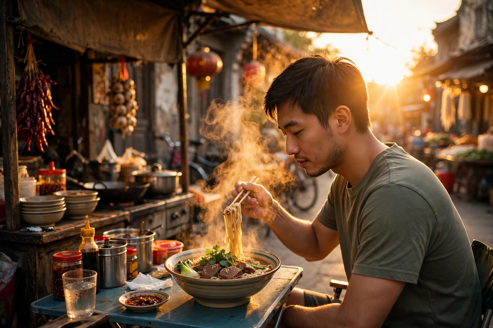
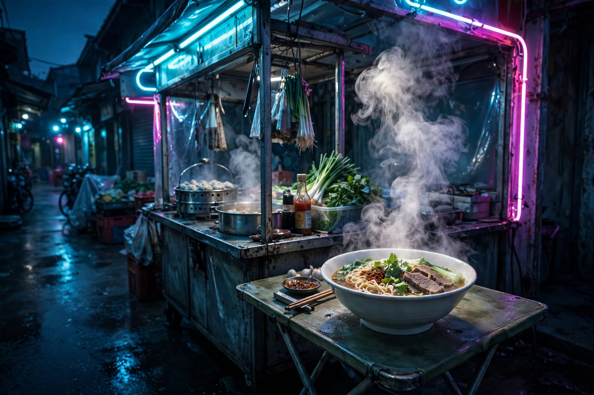

# 引言：先尝一口

郑大钱 28 岁那年，妈妈住院。他想"拍"一张旅行照给妈妈看——一张她没去过的地方。

他没去过那个地方，也不会拍照。他只有一个 AI。于是他写：

> "画一张很美的旅行照片。"

AI 给了他一张很美的照片。妈妈看了说："好看，但跟我没关系。"

问题不在 AI，在他没学会"说"。

真正的摄影师按下快门之前，脑子里已经"尝"过这张照片了：它是甜的还是辣的？是热的还是凉的？是刚出锅的，还是放凉了的？你说不清味道，AI 就只能给你"好看，但跟你没关系"。

## 这本书不教你摄影，教你当导演

AI 是你的摄影师，你是导演。导演不用会按快门，导演要会说："我要傍晚的光，蜂蜜色的，照在一碗刚出锅的面上，热气要看得见。"

一张照片，就是六个旋钮：拍什么、在干什么、在哪、什么光、站哪拍、什么风格。第 1 章我们把六个旋钮一次装好，后面每章只拧透一个。

## 从这一页起，每张图都有味道

这是这本书的规矩：每张配图，我们告诉你两件事——

- **视觉**：它看起来是什么（一句话，说清楚画面）。
- **味道**：它尝起来像什么（一句话，必须是你吃过的东西）。

因为光线和颜色本来就是有味道的：正午的直射阳光是白开水，烫但没味道；黄金时刻的光是蜂蜜，稠的，会顺着碗沿流；霓虹灯是跳跳糖，在舌尖上噼啪响。学会"尝"照片，你就学会了指挥 AI 的一半。

## 怎么用这本书

每章只做三件事：弄懂一个旋钮，做一次可复现的实验，明天交一张图。第一章的作业今天就能交。

## 后路

读完这篇引言，你已经会一件事：以后看到任何一张照片，先别问"好不好看"，先问——

**"它尝起来是什么味道？"**

第 1 章，我们装上六个旋钮。

---

## 配图标准（全书通用，本章首次示范）

1. 每张配图 = 视觉一句 + 味道一句。
2. 味道必须用 13 岁吃过的东西：蜂蜜、烤红薯、冰可乐、薄荷糖、跳跳糖、白开水、锅巴、火锅底料……
3. 禁用空词："氛围感""高级感""质感拉满"不许出现——说不出味道，就不许配图。

### 示范图 1：黄金时刻的面摊

- **视觉**：傍晚的街边面摊，郑大钱挑起一筷子面，热气被夕阳照成金色，辣椒和蒜头挂在摊边。
- **味道**：像咬了一口蜂蜜烤红薯——光是稠的、甜的，顺着碗沿往下流；热气是刚揭开锅盖的那一下，烫得你忍不住眯起眼。整张照片是"趁热吃"的味道。

### 示范图 2：霓虹深夜的面摊

- **视觉**：同一家面摊，深夜，青色和品红霓虹灯管，热气在冷空气里白得发亮，一碗牛肉面是画面里唯一的暖色。
- **味道**：像含着薄荷糖站在冬夜里——空气是脆的、凉的，霓虹是跳跳糖在舌尖上噼啪响；只有那碗面的热气是暖的，像整条街上唯一亮着的一盏灯。同一碗面，换了光，就换了味道——这就是第 4 章要讲的事。

---

**进正文前，先记住两件事**：第一，照片 = 数光子，整本书只有两个主角（光、镜头）加一个你——第 1 章会给你一张地图。第二，这本书有个规矩：所有概念都在"自拍"身上试一遍，你每天拍得最多的东西，就是最好的小白鼠。
